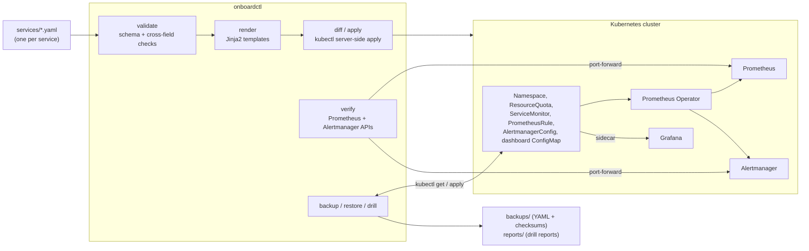

# onboardctl

A command-line tool that onboards a service to a Prometheus-based
observability platform from one small YAML file. It validates the file,
generates the Kubernetes monitoring configuration (scraping, SLO recording
rules and burn-rate alerts, a Grafana dashboard, alert routing), applies it
idempotently, checks that it actually works, and can back up, restore and
drill the recovery of that configuration while measuring how long recovery
takes.

Everything runs locally on a kind cluster. There is no cloud deployment.

- [Why](#why)
- [Quickstart](#quickstart)
- [How it works](#how-it-works)
- [The spec](#the-spec)
- [Commands](#commands)
- [Self-service through Git](#self-service-through-git)
- [Disaster recovery](#disaster-recovery)
- [Automatic remediation (optional)](#automatic-remediation-optional)
- [Azure reference module](#azure-reference-module)
- [Development](#development)
- [Limitations](#limitations)

## Why

Without a self-service path, every team that wants its service monitored
files a request and a platform engineer hand-writes the same set of objects:
a ServiceMonitor, recording rules, alert rules with thresholds worked out
from the team's SLO, a dashboard, an Alertmanager route. That work is
manual, repetitive, grows linearly with the number of services and adds
nothing lasting. It is the definition of toil. It is also error-prone: a
burn-rate threshold copied from another service, or a label selector that
matches nothing, fails silently until the alert that should have fired
does not.

onboardctl turns that into a review of a twenty-line file. The team states
what it knows (who owns the service, where its metrics are, what its
targets are, where alerts should go) and the tool derives everything else
the same way every time. The platform team reviews the spec and owns the
templates, not each service's copy of them. Because the tool also verifies
the result against the running Prometheus and Alertmanager, "onboarded"
means "scraped, rules loaded, routing in place", not "kubectl said
created".

## Quickstart

Requirements: Docker, [kind](https://kind.sigs.k8s.io/), kubectl, helm and
Python 3.11 or newer. On Windows use Docker Desktop with the WSL2 backend;
the commands below work in WSL2 or in Git Bash.

```bash
# 1. A local cluster with a pinned kube-prometheus-stack (about 2 minutes)
scripts/dev-cluster.sh up

# 2. Install the CLI
python -m venv .venv && source .venv/bin/activate   # Git Bash: source .venv/Scripts/activate
pip install -e ".[dev]"                              # or: pipx install .

# 3. Onboard the services in services/
onboardctl validate services/
onboardctl apply services/

# 4. Something for Prometheus to scrape (a stand-in for the teams' real services)
python demo/deploy_workloads.py services/

# 5. Check that it works, then try a recovery drill
onboardctl verify services/
onboardctl drill --yes

# Afterwards
scripts/dev-cluster.sh down
```

`dev-cluster.sh up` switches the current kubectl context to
`kind-onboardctl`. onboardctl uses the current context unless `--context`
is given.

**Windows notes.** `scripts/dev-cluster.sh` converts paths for the Windows
builds of kind and helm when run from Git Bash. In WSL2, install the Linux
builds of kind, kubectl and helm and enable Docker Desktop's WSL
integration. `onboardctl diff` needs a `diff` program; on Windows outside
Git Bash it uses the one that ships with Git for Windows. The kind node
config sets `failCgroupV1: false` because Docker Desktop's VM can still run
cgroup v1, which recent kubelets otherwise refuse.

## How it works



1. **Spec in.** `spec.py` parses the YAML (rejecting duplicate keys),
   validates it with pydantic, then runs checks across fields that a schema
   cannot express, such as "every route names a receiver that exists".
2. **Manifests out.** `render.py` fills the templates in
   `src/onboardctl/templates/`. The PromQL is built in `rules.py` from the
   SLO targets (`slo.py` holds the burn-rate arithmetic) and the dashboard in
   `dashboard.py`. Output is deterministic, so it can be checked against
   golden files.
3. **Cluster state.** `cluster.py` runs `kubectl diff` and
   `kubectl apply --server-side` with a fixed field manager. Every object
   carries `app.kubernetes.io/managed-by=onboardctl` and
   `onboardctl/service=<name>`, which is how `list`, `offboard`, `backup` and
   `verify --all` find them later.
4. **Verification.** `verify.py` derives what should exist from the
   manifests (rendered from a spec, read from a backup, or read back from the
   cluster) and checks it against kubectl, the Prometheus HTTP API and the
   Alertmanager API, retrying while the operator and config reloaders catch
   up.
5. **Backup and restore.** `dr.py` exports the managed objects without
   server-populated fields, writes a checksummed index, and re-applies them
   in dependency order. The drill strings these together and times them.

### Why kubectl and not a client library

onboardctl shells out to `kubectl` (`kube.py`) instead of using the
Kubernetes Python client. Every action is a kubectl command an engineer can
rerun by hand to see what happened (`--verbose` prints them), it uses the
same kubeconfig, contexts and auth plugins as the rest of their tooling, and
`kubectl diff` and server-side apply already implement the hard parts of
idempotent updates. The cost is parsing JSON from a subprocess and depending
on a kubectl binary, which every machine that talks to a cluster has anyway.

### How verify reaches Prometheus

By default `verify` and `drill` start `kubectl port-forward` to the
`kps-prometheus` and `kps-alertmanager` Services in the `monitoring`
namespace, on a free local port chosen by kubectl, and stop it when the
command ends. Nothing needs to be exposed. To use endpoints you already
have, set `ONBOARDCTL_PROMETHEUS_URL` and `ONBOARDCTL_ALERTMANAGER_URL` (or
the `--prometheus-url` and `--alertmanager-url` options). The namespace and
Service names are options too.

## The spec

```yaml
apiVersion: onboardctl/v1
name: checkout-api                 # DNS label, at most 40 characters
team: payments
owners:                            # email addresses or GitHub handles
  - payments-oncall@example.com
  - "@example-org/payments"
description: Public checkout API   # optional
namespace: payments-checkout       # optional, defaults to name

metrics:
  port: http-metrics               # name (not number) of the Service port
  path: /metrics                   # default /metrics
  interval: 15s                    # 10s to 5m, default 30s
  selector:                        # Service labels, default app.kubernetes.io/name: <name>
    app.kubernetes.io/name: checkout-api

slo:
  window: 30d                      # 7d, 28d or 30d, default 30d
  availability:
    target: 99.9                   # percent of requests that do not fail
  latency:                         # optional
    thresholdSeconds: 0.25         # must be a bucket bound of the histogram
    target: 99                     # percent of requests faster than the threshold
  metrics:                         # optional, these are the defaults
    requests: http_requests_total
    errorSelector: 'code=~"5.."'
    latencyHistogram: http_request_duration_seconds

alerting:
  defaultReceiver: payments-tickets
  receivers:
    - name: payments-pager
      webhookUrl: https://hooks.example.com/payments/pager
    - name: payments-tickets
      webhookUrl: https://hooks.example.com/payments/tickets
  routes:                          # optional: severity -> receiver
    - severity: critical
      receiver: payments-pager
  runbookUrl: https://runbooks.example.com/payments/checkout-api   # optional

dashboard:
  enabled: true                    # default true

quota:                             # optional, these are the defaults
  cpu: "2"                         # requests.cpu
  memory: 4Gi                      # requests.memory
  pods: 20

remediation:                       # optional, see "Automatic remediation"
  restartDeployment: checkout-api
```

Examples: [`examples/api-strict.yaml`](examples/api-strict.yaml) (tight
targets, paging, remediation),
[`examples/batch-relaxed.yaml`](examples/batch-relaxed.yaml) (28-day window,
looser targets, custom selector, path and error selector, no dashboard) and
[`examples/invalid.yaml`](examples/invalid.yaml) (deliberately broken).

### What gets generated

| Object | Name | Purpose |
| --- | --- | --- |
| Namespace | `namespace` | Team and service labels, owners annotation, baseline Pod Security. |
| ResourceQuota | `<name>-quota` | Caps on pods and CPU/memory requests. Pods in the namespace must then declare requests. |
| ServiceMonitor | `<name>` | Scrapes the named port; relabels `job` to the service name so the rules do not depend on the Service object's name. |
| PrometheusRule | `<name>-slo` | Recording rules for the error ratio over 5m, 30m, 1h, 6h and 3d per SLI; burn-rate alerts; a scrape-target-missing alert. |
| AlertmanagerConfig | `<name>-routing` | Routes the service's alerts to its receivers by severity. The operator adds a namespace matcher. |
| ConfigMap | `<name>-slo-dashboard` | Grafana dashboard (SLI, budget remaining, burn rate, traffic), loaded by the Grafana sidecar. |
| Role, RoleBinding | `<name>-responder` | Only with `remediation`; see below. |

Every object also carries the annotation `onboardctl/spec-hash`, a hash of
the whole spec. A side effect is that any change to a spec shows up in
`diff` on every object, because the annotation changes.

### Burn-rate alerts

The alerts follow the multi-window, multi-burn-rate scheme from the Google
SRE Workbook. Each tier fires when the error ratio over both a long and a
short window would, if it continued, spend a given share of the whole error
budget within the long window:

| Severity | Long / short window | Budget spent | Factor (30d) | Threshold at 99.9% |
| --- | --- | --- | --- | --- |
| critical | 1h / 5m | 2% | 14.4 | 1.44% errors |
| critical | 6h / 30m | 5% | 6 | 0.6% errors |
| warning | 3d / 6h | 10% | 1 | 0.1% errors |

The factors are computed from the SLO window, so a 28-day or 7-day window
gets its own. `validate` warns when a target is so loose that a tier could
never fire (for example 90% over 30 days needs a 144% error ratio for the
fast page). The tests in
[`tests/promtool/checkout-api.test.yaml`](tests/promtool/checkout-api.test.yaml)
feed synthetic series through the rendered rules and check which tiers fire
at 10%, 0.8% and 0.05% errors.

## Commands

Exit codes: 0 success; 1 a check failed (invalid spec, failed verification,
or differences found by `diff`); 2 usage error; 3 the environment is not
usable (kubectl missing, cluster or Prometheus unreachable, bad backup).
Spec arguments accept files or directories.

All output below is from real runs against the local kind cluster.

### validate

```
$ onboardctl validate examples/api-strict.yaml examples/batch-relaxed.yaml services/
ok   examples/api-strict.yaml (service checkout-api, namespace payments-checkout)
ok   examples/batch-relaxed.yaml (service invoice-batch, namespace invoice-batch)
ok   services/notification-worker.yaml (service notification-worker, namespace notification-worker)
ok   services/search-api.yaml (service search-api, namespace search)
```

Errors name the field, say what is wrong and show valid input:

```
$ onboardctl validate examples/invalid.yaml
FAIL examples/invalid.yaml: 7 problem(s)
  name: 'Checkout_API' is not a valid name: use lowercase letters, digits and '-', starting and ending with a letter or digit
      example: name: checkout-api
  owners[0]: 'not-an-email' is neither an email address nor a GitHub handle such as @org/team
      example: - alice@example.com   (or a GitHub handle such as @example-org/payments)
  metrics.port: got the number 8080; a ServiceMonitor selects a Service port by name, so give the port's name instead
      example: port: http-metrics   (the name of the Service port)
  metrics.pathh: unknown field; did you mean 'path'? Valid fields here: port, path, interval, selector.
  slo.availability.target: must be greater than 0 and less than 100 (got 100); it is a percentage, and 100 would leave no error budget
      example: target: 99.9
  slo.latency.target: required field is missing
      example: target: 99
  alerting.receivers[0].webhookUrl: 'hooks.example.com/pager' is not an http:// or https:// URL
      example: webhookUrl: http://alert-relay.payments.svc:8080/hook
```

Given several specs together, it also rejects two that claim the same
service name or namespace.

### render

```
$ onboardctl render examples/api-strict.yaml -o rendered --rules-dir rendered/rules
rendered/checkout-api/00-namespace.yaml
rendered/checkout-api/01-resourcequota.yaml
rendered/checkout-api/02-servicemonitor.yaml
rendered/checkout-api/03-prometheusrule.yaml
rendered/checkout-api/04-alertmanagerconfig.yaml
rendered/checkout-api/05-configmap.yaml
rendered/checkout-api/06-role.yaml
rendered/checkout-api/07-rolebinding.yaml
rendered/rules/checkout-api.rules.yaml
```

`--rules-dir` also writes the rules as a plain Prometheus rule file for
`promtool`. The expected output for each example is in
[`tests/golden/`](tests/golden/).

### diff

```
$ onboardctl diff services/notification-worker.yaml
== notification-worker: changes
namespace notification-worker does not exist yet; apply would create:
  + Namespace/notification-worker
  + ResourceQuota/notification-worker-quota
  + ServiceMonitor/notification-worker
  + PrometheusRule/notification-worker-slo
  + AlertmanagerConfig/notification-worker-routing
  + ConfigMap/notification-worker-slo-dashboard
```

For an existing service this is the output of `kubectl diff --server-side`,
which also shows drift: in one test run, after a ServiceMonitor was deleted
and a quota edited by hand, `diff` showed both, and `apply` put both back.
Like `kubectl diff`, it exits 1 when there are differences.

### apply

```
$ onboardctl apply services/notification-worker.yaml
notification-worker: applied
  namespace/notification-worker serverside-applied
  resourcequota/notification-worker-quota serverside-applied
  servicemonitor.monitoring.coreos.com/notification-worker serverside-applied
  prometheusrule.monitoring.coreos.com/notification-worker-slo serverside-applied
  alertmanagerconfig.monitoring.coreos.com/notification-worker-routing serverside-applied
  configmap/notification-worker-slo-dashboard serverside-applied

$ onboardctl apply services/
notification-worker: no changes
search-api: no changes
```

`apply` runs the diff first and does nothing when it is empty, so re-running
it is safe and visibly a no-op. It uses server-side apply with the field
manager `onboardctl` and `--force-conflicts`: the spec in Git is the source
of truth, so a field someone changed by hand is taken back. `--dry-run`
shows the diff and validates the change on the API server without
persisting it. Before touching anything it checks that the Prometheus
Operator CRDs exist.

### verify

```
$ onboardctl verify services/notification-worker.yaml --timeout 300
  waiting: 3 check(s) failing after 0s, retrying
  ...
  waiting: 2 check(s) failing after 79s, retrying
notification-worker (namespace notification-worker)
  [PASS] Namespace notification-worker exists
  [PASS] ResourceQuota notification-worker-quota exists
  [PASS] ServiceMonitor notification-worker exists
  [PASS] PrometheusRule notification-worker-slo exists
  [PASS] AlertmanagerConfig notification-worker-routing exists
  [PASS] ConfigMap notification-worker-slo-dashboard exists
  [PASS] Prometheus scrapes the service: 1/1 targets up
  [PASS] rule group onboardctl.notification-worker.recording loaded: 5 rules, all evaluating
  [PASS] rule group onboardctl.notification-worker.alerts loaded: 4 rules, all evaluating
  [PASS] Alertmanager has the routing config: 1 receiver(s)
  [PASS] SLI has data: slo:availability_error_ratio:rate5m: error ratio 0.0006676
  result: PASS (11 passed, 0 failed, 0 warnings)
```

This run started right after a fresh apply, so the first minute or so is
the Prometheus Operator's change reaching the Prometheus pod (see the drill
below). "SLI has data" is only a warning when it fails: a correctly
onboarded service with no traffic has no data. For a latency SLI with no
series it points at the usual cause, a `thresholdSeconds` that is not one of
the histogram's bucket bounds. `verify --all` checks everything onboarded in
the cluster instead of the given specs. `--timeout 0` checks once.

### list

```
$ onboardctl list
SERVICE              NAMESPACE            TEAM       OBJECTS  SPEC              OWNERS
checkout-api         payments-checkout    payments   8        7d28ca8a1a42e699  payments-oncall@example.com,@example-org/payments
invoice-batch        invoice-batch        billing    5        383bd0dd7ac037ed  billing-team@example.com
notification-worker  notification-worker  messaging  6        8dfc38780a591d46  messaging-team@example.com
search-api           search               search     6        df51fea9b54112ce  search-team@example.com,@example-org/search
```

`SPEC` shows `mixed` if a service's objects carry different spec hashes,
which means an apply was interrupted or someone edited the objects.

### offboard

```
$ onboardctl offboard notification-worker --yes --delete-namespace
deleted notification-worker/resourcequotas/notification-worker-quota
deleted notification-worker/servicemonitors.monitoring.coreos.com/notification-worker
deleted notification-worker/prometheusrules.monitoring.coreos.com/notification-worker-slo
deleted notification-worker/alertmanagerconfigs.monitoring.coreos.com/notification-worker-routing
deleted notification-worker/configmaps/notification-worker-slo-dashboard
deleted namespace/notification-worker
```

Without `--delete-namespace`, the namespace is kept if anything still runs
in it (deleting a namespace deletes the team's workloads too). onboardctl
then removes its labels and annotations from it, so the service no longer
counts as onboarded. Without `--yes` it asks for confirmation and shows the
kubectl context.

### backup and restore

```
$ onboardctl backup -o backups/example
backed up 25 objects for 4 services to backups/example

$ onboardctl restore backups/example --dry-run
namespace/payments-checkout serverside-applied (server dry run)
namespace/invoice-batch serverside-applied (server dry run)
...
role.rbac.authorization.k8s.io/checkout-api-responder serverside-applied (server dry run)
rolebinding.rbac.authorization.k8s.io/checkout-api-responder serverside-applied (server dry run)
```

A backup is one YAML file per object under `<dir>/<service>/`, with
server-populated fields (uid, resourceVersion, managedFields, status)
removed so it diffs cleanly in Git, plus `backup.json` listing every file
with its SHA-256. The index is written last, so an interrupted backup has
none. `restore` refuses a backup without an index, with a missing file or
with a file that does not match its checksum, then applies namespaces first
and everything else after.

### drill

Described in [Disaster recovery](#disaster-recovery).

## Self-service through Git

The intended workflow: services live as spec files under
[`services/`](services/). A team adds or changes its file in a pull
request; the platform team reviews a small YAML diff instead of
hand-written manifests.

[`.github/workflows/onboarding.yml`](.github/workflows/onboarding.yml) runs
on such pull requests:

1. **validate-render**: finds the changed specs, validates all specs
   together (so duplicate names or namespaces are caught), renders the
   changed ones, runs kubeconform and `promtool check rules` on the output,
   and uploads the rendered manifests as the `rendered-manifests` artifact
   for reviewers.
2. **e2e-kind**: creates a kind cluster inside the job with
   `scripts/dev-cluster.sh`, applies everything in `services/`, deploys the
   demo workloads, re-applies and requires `diff` to be empty, runs
   `verify`, runs a DR drill and uploads its report.

**The kind cluster in that job is a test fixture, not a platform.** It
exists for the length of the job and proves that the specs and the tool
work end to end; nothing is deployed anywhere. In a real setup the merge to
main would be picked up by a GitOps controller or a deploy job with real
credentials.

[`.github/workflows/ci.yml`](.github/workflows/ci.yml) runs ruff, mypy and
pytest on Python 3.11 and 3.13, kubeconform and promtool (check and unit
tests) on the rendered examples, and shellcheck.
[`.github/workflows/terraform.yml`](.github/workflows/terraform.yml) checks
the Terraform module. These workflows have not been run on GitHub yet; their
steps were run locally with the same tools.

## Disaster recovery

### What the drill does

```
onboardctl drill --yes
```

1. **Baseline verify.** If anything is already failing, the drill stops:
   a recovery time measured from a broken start means nothing.
2. **Backup** to `backups/drill-<time>/`.
3. **Delete** every onboarded object except the namespaces. Namespaces stay
   because deleting them would delete the teams' workloads, which onboardctl
   neither owns nor backs up.
4. **Wait until Prometheus has dropped the config**: the rule groups and
   scrape targets are gone. Without this, the verify after the restore could
   pass against stale state.
5. **Restore** from the backup.
6. **Verify** until every check passes, and record the time.

It writes a Markdown report to `reports/` with UTC timestamps, the duration
of each step, the recovery time and the final checklist. It refuses to run
against a context whose name does not start with `kind-` unless given
`--allow-any-context`.

### Results

The reports in [`reports/`](reports/) are from real runs on the local kind
cluster (one node, four onboarded services, Docker Desktop on Windows 11):

| Report | Objects | Outcome | Restore start to all checks passing |
| --- | --- | --- | --- |
| [drill-20261106T145230Z](reports/drill-20261106T145230Z.md) | 25 | FAIL | not recovered |
| [drill-20261106T145447Z](reports/drill-20261106T145447Z.md) | 25 | PASS | 112.7 s |

The failed run found a real bug. The backup kept only `spec` and `data`
from each object, but a Role keeps its permissions in `rules` and a
RoleBinding in `roleRef` and `subjects`, so the restore was rejected with
`unsupported role reference kind`. Earlier drills had passed because those
kinds did not exist yet. The fix keeps every top-level field except
`status`, and a regression test covers it. An earlier passing drill, before
the Role and RoleBinding were added, measured 117.8 s.

Almost all of the recovery time is propagation, not onboardctl. In the
earlier drill, the restore was accepted by the API server at 12:37:58 and
the operator synced at once, but Prometheus's config-reloader only reloaded
at 12:39:27 and Alertmanager's at 12:39:20: the updated config Secrets take
over a minute to appear in the pods' mounted volumes. The rest is the first
scrape and the first rule evaluation (one service scrapes every 60 s). A
faster restore tool would not move this number much.

### RTO and RPO for this design

- **RTO** (how long until it works again) is what the drill measures: about
  two minutes here, dominated by config propagation.
- **RPO** (how much is lost) for configuration is close to zero when specs
  live in Git, since `onboardctl apply services/` can rebuild everything
  without any backup. The backup covers what Git does not: the state as
  actually deployed, including drift, at the moment it was taken. A backup's
  RPO is the time since it was taken.

### What is not recovered: metric history

This restores **configuration**, not **data**. The time series stored by
Prometheus (its TSDB) are not backed up. On the dev cluster Prometheus has
no persistent volume, so restarting its pod loses all history; even with a
volume, losing the volume or the cluster loses it. After such a loss the
restored rules start from nothing: SLO windows of 30 days and the 3-day
burn-rate window need that long to fill again, and alerts are blind until
the short windows have data.

Long-term storage addresses that. With Thanos, a sidecar next to each
Prometheus uploads its TSDB blocks (every two hours by default) to object
storage such as Azure Blob Storage, and a Thanos Query and Store gateway
serve queries across the recent local data and the uploaded history. Losing
a Prometheus then loses at most the last un-uploaded block, and a rebuilt
cluster can query the old history immediately. Object storage brings its
own durability (replication, versioning, soft delete) and retention is set
by the compactor rather than by local disk. Azure Monitor managed Prometheus
is the managed alternative. None of this is implemented here; the companion
project `slo-lab` sets up a Thanos sidecar on kind.

## Automatic remediation (optional)

[`responder/`](responder/) is a small webhook service that receives
Alertmanager notifications and performs one action: a rollout restart of a
Deployment, only for the fast availability burn-rate alert, only for
services whose spec opts in with `remediation.restartDeployment`, at most
once per 30-minute cooldown. Before acting it asks Alertmanager whether the
alert is really firing, so a forged webhook cannot cause a restart. Every
decision is one JSON line in its log.

For an opted-in spec, onboardctl renders a Role and RoleBinding in that
namespace allowing `get` and `patch` on exactly that one Deployment; the
responder has no other permissions. On the dev cluster:

- with the demo app set to 30% errors, the responder restarted
  `checkout-api` 94 s after the error rate went up;
- a repeated notification was logged as `rate_limited`, a forged one for a
  healthy service and a latency alert as `ignored`;
- `kubectl auth can-i` confirmed it can patch that Deployment and cannot
  patch others, list Deployments, delete anything or read Secrets.

Why it is limited to one alert, and its limits, are in
[`responder/README.md`](responder/README.md).

## Azure reference module

[`terraform/`](terraform/) contains a module for an AKS cluster with a Log
Analytics workspace (container logs, control plane logs, Entra ID auth,
Cilium network policy). **It is a validated reference module, not something
deployed.** It has never been applied; CI runs only `terraform validate` and
`tflint`. See [`terraform/README.md`](terraform/README.md).

## Development

```bash
pip install -e ".[dev]"
ruff check . && ruff format --check . && mypy
pytest                                   # unit and golden-file tests
UPDATE_GOLDEN=1 pytest tests/test_render.py   # after an intended template change; review the diff

onboardctl render examples/api-strict.yaml examples/batch-relaxed.yaml services/ -o rendered --rules-dir rendered/rules
promtool check rules rendered/rules/*.yaml
promtool test rules tests/promtool/*.test.yaml
```

Layout:

| Path | Contents |
| --- | --- |
| `src/onboardctl/spec.py` | Spec models, YAML loading, validation and error messages |
| `src/onboardctl/slo.py`, `rules.py`, `dashboard.py` | Burn-rate arithmetic, PromQL, dashboard |
| `src/onboardctl/render.py`, `templates/` | Jinja2 rendering |
| `src/onboardctl/kube.py`, `cluster.py` | kubectl wrapper; diff, apply, list, offboard |
| `src/onboardctl/prom.py`, `verify.py` | Prometheus and Alertmanager access; verification |
| `src/onboardctl/dr.py` | Backup, restore, drill and report |
| `src/onboardctl/cli.py` | Typer command-line interface |
| `cluster/`, `scripts/dev-cluster.sh` | kind config and pinned kube-prometheus-stack values |
| `demo/` | Stand-in workloads for the onboarded services (demo and CI only) |
| `responder/` | Remediation responder |
| `terraform/` | Azure reference module |

## Limitations

- **Local only.** Everything has run on a single-node kind cluster on one
  machine. Nothing has been deployed to a cloud or a shared cluster, and
  there are no numbers here for scale (hundreds of services, large rule
  counts, a busy Alertmanager).
- **WSL2 is untested.** `scripts/dev-cluster.sh` and everything else here
  were run from Git Bash on Windows 11. The script is plain bash and should
  work in WSL2 with Linux builds of the tools, but that has not been tried.
- **The GitHub Actions workflows have not run on GitHub yet.** Their steps
  were run locally; the first real run may still need small fixes.
- **Configuration, not data.** Backups restore what onboardctl manages, not
  metric history, dashboards edited in Grafana's UI, or the teams'
  workloads.
- **Assumes kube-prometheus-stack.** The Service names, the Grafana
  dashboard label and the operator's CRDs are assumptions, configurable
  only through options. The Alertmanager must select AlertmanagerConfigs
  labeled `app.kubernetes.io/managed-by=onboardctl`, as
  `cluster/kube-prometheus-stack-values.yaml` does.
- **SLIs follow one metric shape:** a request counter with a status label
  and a latency histogram. Latency thresholds must equal a bucket bound and
  are formatted like the Go client writes `le` (`1`, not `1.0`).
- **One spec per namespace, one namespace per spec.** There is no support
  for several services sharing a namespace.
- **No access control of its own.** onboardctl can do whatever the kubectl
  context can. In a real platform the apply step would run in CI with a
  scoped identity, and teams would not run it against production.
- **The demo app simulates its own traffic.** The SLI numbers in the output
  above come from synthetic requests, not real load.
- **NetworkPolicy is not enforced on the kind cluster,** so the responder's
  policy is untested there; it relies on the Alertmanager check instead.
